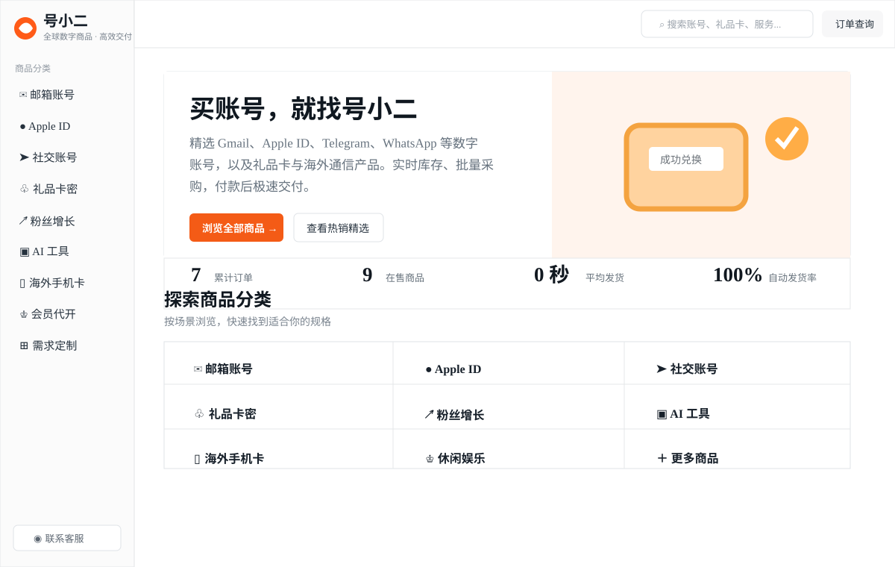

# 号小二海外账号、数字商品与跨境通信使用指南

## 访问号小二网站

[立即访问号小二网站 →](https://haoxiaoer.github.io/)

号小二海外账号、数字商品与跨境通信使用指南。

## 号小二服务范围

号小二主要面向需要海外账号、数字商品和跨境通信产品的用户，提供 Gmail、Apple ID、Telegram、WhatsApp、礼品卡、AI 工具、海外手机卡等相关信息与商品入口。不同商品的地区限制、库存、交付方式和使用条件可能不同，具体内容请以[号小二官方网站](https://www.haoxiaoer.com/)当前页面和结算页为准。

## 热门使用指南

- 美国电话卡和 eSIM：选择实体卡、eSIM 或接码服务前，先确认设备频段、所在地区、实名要求和套餐有效期。
- Gmail 和 Google 账号：购买或使用前，确认账号类型、登录方式、恢复邮箱、双重验证和地区限制。
- Apple ID：确认账号地区、付款方式、受信任设备和恢复信息，避免在不熟悉的设备上保存敏感资料。
- Telegram、WhatsApp 等社交账号：首次登录后及时检查绑定信息和安全设置，不要把验证码交给任何人。
- 礼品卡与 AI 工具：兑换前核对国家或地区、面值、适用平台和兑换规则。

## 文章专栏

这里是号小二在 GitHub 仓库里的文章目录。现有内容先按主题收在下面，后续的新文章也会继续补进对应系列，查找起来更方便。

### 海外账号使用

- [2026 年 Gmail 账号交易平台有哪些？5 大主流平台推荐](https://www.haoxiaoer.com/blog/gmail-account-trading-platforms)
- [美区 Apple ID 有什么用途？海外苹果账号完整介绍](https://www.haoxiaoer.com/blog/account-what-is-us-apple-id-for)

### 账号采购与团队管理

- [跨境团队如何高效管理海外账号？账号采购标准化实操指南](https://www.haoxiaoer.com/blog/account-guide-how-can-cross-border-teams)

### 礼品卡与跨境工具

- [App Store 怎么更换国家或地区？iOS 账号转区避坑与实操指南](https://www.haoxiaoer.com/blog/account-guide-how-to-change-your-app)
- [查看更多号小二文章](https://www.haoxiaoer.com/blog)

以后发布新文章时，只要把文章标题和链接加到对应系列即可；如果内容较长，也可以在仓库中新建单独的 Markdown 文件，再从这里进入。

## GitHub 原创文章专栏

想了解更多海外数字账号、Gmail 邮箱、Apple ID、X Premium、Telegram 会员等相关资讯，可以进入下面的资讯专栏，查看更多使用指南和实用内容。

[进入号小二 GitHub 文章专栏 →](/haoxiaoer/haoxiaoer.github.io/blob/main/articles/README.md)

## 购买前检查清单

1. 明确自己需要的账号类型、地区和使用场景。
2. 阅读商品页面的交付说明、有效期、限制条件和售后说明。
3. 收到商品后尽快完成登录验证，并保存订单信息和必要的恢复资料。
4. 不要在公共设备上保存密码、验证码或支付信息。
5. 遇到登录、兑换或激活问题时，先查看对应商品页面的说明，再联系官方支持。

## 常见问题

### 商品信息会一直不变吗？

不会。账号状态、库存、地区政策、运营商套餐和第三方平台规则都可能变化。下单前请以当前商品页和结算页显示的信息为准。

### 收到账号后应该先做什么？

建议先确认登录是否正常，再检查绑定邮箱、手机号、受信任设备、双重验证和恢复选项。涉及第三方平台时，也要遵守平台的服务条款和安全要求。

### Gmail、Apple ID 等海外账号登录不了怎么办？

先确认账号、密码和验证码输入无误，再检查商品页面标注的地区、设备和登录要求。遇到异常验证、地区限制或登录失败时，不要连续重复尝试；请保留订单号和报错信息，联系号小二客服核对商品规格和后续处理方式。

## 访问号小二官方网站

需要查看当前商品、库存、价格和服务说明，请访问[号小二官方网站](https://www.haoxiaoer.com/)。

最后更新：2026-10-25
